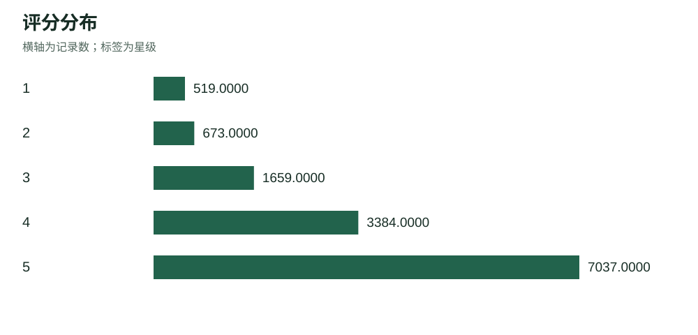
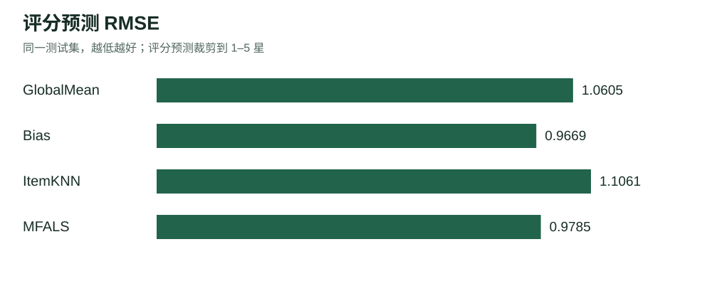
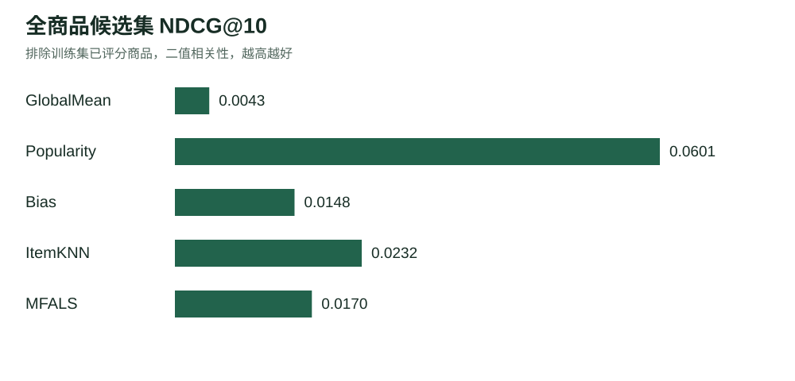

# Amazon 园艺商品评分预测与 Top-10 推荐实验报告

## 1 研究目标与实验结论

本项目使用 Amazon Patio, Lawn and Garden 5-core 数据，完成按用户划分、评分预测和 Top-10 推荐。实验比较全局均值、偏置基线、物品协同过滤、显式反馈矩阵分解，并增加热门推荐作为排序对照。
在训练集内部验证后，评分任务预选模型为 Bias，排序任务预选模型为 Popularity。下表展示各模型最终测试结果。测试集只用于最终比较，不参与选参或选择部署模型。

## 2 数据与预处理

原始文件包含 13,272 条去重后记录、1,686 位用户、962 件商品。矩阵密度为 0.8183%，平均评分为 4.1865。评分日期为 2000-04-05 至 2014-07-22。每位用户至少 5 条记录，每件商品至少 5 条记录。
程序校验用户 ID、商品 ID 和 1–5 整数评分。相同用户与商品只保留最新记录，本次移除 0 条重复记录。评论正文、摘要、时间和 helpful 字段随记录保留。模型仅使用用户 ID、商品 ID、评分，不使用测试评论或测试评分构造特征。数据不包含商品元数据与图像向量，因此推荐结果以 ASIN 展示。helpful 字段保留原样，未用于建模。



## 3 可复现实验协议

外层随机种子为 42，逐用户打乱后取 floor(0.8×n) 条作为训练集，其余作为测试集。当记录数不能整除时，实际比例会偏离 80%。不为保证测试商品在训练集中出现而交换样本。
| 数据子集 | 记录数 | 用途 |
|---|---:|---|
| train | 10,054 | 外层训练及最终拟合 |
| test | 3,218 | 最终评分与排序评估 |
| fit | 7,552 | 内层参数训练 |
| validation | 2,502 | 选参及预选模型 |

实际外层训练占比为 75.75%。fit 与 validation 是 train 的不相交子集，各用户在 train 内再按相同规则进行 80%/20% 划分，内层种子为外层种子加一。选参完成后，在完整 train 上重新训练，再评估 test。
外层训练中完全未出现的目录商品数为 2，对应测试记录 10 条。商品目录由原始数据的唯一 ASIN 构成，假设目录已知；目录使用商品标识，不使用任何测试交互标签。冷商品使用均值或偏置回退，其潜在因子为零。对完全未知的外部用户或商品评分查询，返回训练均值。

## 4 算法

GlobalMean 对所有用户与商品预测训练集均值，作为最低复杂度对照。排序同分时按 ASIN 字典序，故其 Top-10 指标只作为对照。
Bias 使用 r_hat(u,i)=μ+b_u+b_i，固定 μ 为训练均值，交替求解带 L2 正则的用户偏置和商品偏置。优化目标为已观测评分上的平方误差加 reg×(用户偏置平方和+商品偏置平方和)。
ItemKNN 先拟合 Bias，将已观测评分减去 μ+b_u+b_i，缺失位置置零。物品相似度为残差向量余弦相似度，再乘共同评分人数 c/(c+shrinkage)。只保留正相似度，对每个目标商品，从该用户已评分商品中选择最多 k 个邻居。预测为偏置基线加邻居残差的加权平均；没有可用邻居时回退到偏置基线。此实现使用完整残差向量范数，属于带收缩的残差余弦变体，不声称严格复现 Sarwar 原论文所有细节。
MFALS 先固定 Bias，再优化 r_hat(u,i)=μ+b_u+b_i+p_u·q_i。目标只包含已观测评分的平方误差，加 factor_reg×(用户因子平方和+商品因子平方和)，交替求解两个因子矩阵的正则最小二乘。每个用户和商品的正则系数固定，不按评分数缩放；缺失条目不当作零评分参与目标。它是显式反馈 ALS，不是隐式反馈 ALS。
Popularity 只按训练集中商品评分次数排序，不使用评分值，是独立的排序基线，因此不报告其 MAE 与 RMSE。

## 5 指标定义

评分指标：MAE=mean(|r−r_hat|)，RMSE=sqrt(mean((r−r_hat)²))。评分预测裁剪到 [1,5]，排序使用未裁剪得分以保留大小关系。
排序候选为整个已知商品目录减去该用户训练集中已评分商品，不采样负例。相关集合 T_u 为该用户所有测试商品，不额外筛选 rating≥4。推荐列表 L_u 长度为 10，P_u=|L_u∩T_u|/10，R_u=|L_u∩T_u|/|T_u|。Precision 和 Recall 分别对用户宏平均。按课程公式 F-measure=2×P_macro×R_macro/(P_macro+R_macro)。另存 macro_f1，即逐用户 F1 的平均，避免混淆这两个定义。
NDCG 使用二值相关性，DCG@10=sum(hit_j/log2(j+1))，IDCG 为 min(10,|T_u|) 个相关项的理想 DCG，再对用户取平均。目录覆盖率为所有推荐列表中不同商品数量除以目录商品总量。同分推荐按 ASIN 字典序确定，保证重复运行一致。

## 6 验证与测试结果

各评分模型的参数按验证 RMSE 最小选择。排序任务在这些已选配置与热门基线中，按验证 NDCG 最大预选模型。因此排序结果并非每个算法单独以 NDCG 调参后的上限。完整候选参数、验证指标和用时见 validation_trials.json。

| 模型 | 验证 RMSE | 验证 NDCG@10 | 最终参数 |
|---|---:|---:|---|
| GlobalMean | 1.108408 | 0.002927 | {} |
| Popularity | 不适用 | 0.058161 | {} |
| Bias | 1.004772 | 0.018005 | {'reg': 5.0} |
| ItemKNN | 1.103214 | 0.025289 | {'neighbors': 10, 'shrinkage': 5.0, 'reg': 15.0} |
| MFALS | 1.018051 | 0.020861 | {'factors': 8, 'factor_reg': 10.0, 'epochs': 20, 'reg': 15.0, 'seed': 42} |

| 模型 | MAE | RMSE | P@10 | R@10 | F-measure | NDCG@10 |
|---|---:|---:|---:|---:|---:|---:|
| GlobalMean | 0.852193 | 1.060500 | 0.001601 | 0.009559 | 0.002743 | 0.004260 |
| Popularity | 不适用 | 不适用 | 0.017556 | 0.079844 | 0.028784 | 0.060129 |
| Bias | 0.741726 | 0.966929 | 0.003559 | 0.020057 | 0.006045 | 0.014833 |
| ItemKNN | 0.805930 | 1.106110 | 0.006406 | 0.039207 | 0.011012 | 0.023166 |
| MFALS | 0.773214 | 0.978459 | 0.004389 | 0.024002 | 0.007421 | 0.016984 |





## 7 结果分析与局限

本次测试表中 RMSE 最低的模型为 Bias，RMSE=0.966929。这是描述性比较，不据此重新选择超参数。
本次测试表中 NDCG@10 最高的是 Popularity，NDCG@10=0.060129。评分误差与排序指标衡量不同目标，需要分别解释。
数据稀疏且 4–5 星占多数，均值与正则偏置可能具有较强竞争力。模型复杂度更高并不保证在小样本上更好。这是一种可能解释，本实验未通过因果或显著性检验验证。
本次结果来自单次随机划分，未提供置信区间，不能证明模型间差异在所有划分中稳定。逐用户随机划分符合课程建议，但不是严格的时间外推测试，可能让较晚交互参与较早交互预测。随机划分时整条评论一起移动，未读取测试评论进行训练。
未观测商品不等于用户不喜欢，Top-10 指标只根据有限的测试交互计算。全部测试商品视为相关也包含低分商品，这是课程指标口径；若扩展为高分正反馈评估，必须单独报告，不能直接与本表混用。
实现使用稠密矩阵，适合本次 1,686×962 规模，内存随用户数乘商品数增长。更大数据应使用稀疏矩阵和分块候选评分。本项目不使用评论、图像或商品元数据增强特征，后续可在严格训练数据边界内开展这些扩展。

## 8 复现与提交

运行环境为 Python 3.10+ 与 NumPy。源代码包含数据加载、五种模型、完整评估与报告生成。

```powershell
python -m pip install -r requirements.txt
python -m gardenrec run --config configs/default.json
python -m unittest discover -s tests -v
```

本次运行 Python=3.12.14，NumPy=2.3.5。数据 SHA256 为 `119612a8dc9dd6967ef74ea23d447d83e8adbfbe144c9f89b2ba39e72fda077f`。manifest.json 记录实际配置、版本和时间；splits/indices.npz 保存固定划分索引。
metrics.json 与 comparison.csv 保存汇总指标；predictions 保存逐条评分预测；per_user 保存逐用户指标；recommendations 保存各用户 Top-10；models 保存不依赖 pickle 的 NPZ 模型。报告和幻灯片使用这些实际运行结果。
提交打包脚本仅包含代码、配置、说明、汇总结果、报告及幻灯片，不包含原始数据、拆分评论或训练模型。提交前在报告和幻灯片中补充组员、学号、分工等课程要求的身份信息。

## 9 参考文献

[Amazon Reviews 2014 数据与字段说明](https://cseweb.ucsd.edu/~jmcauley/datasets/amazon/links.html)
[Sarwar et al. Item-Based Collaborative Filtering Recommendation Algorithms. WWW 2001.](https://files.grouplens.org/papers/www10_sarwar.pdf)
[Koren, Bell, Volinsky. Matrix Factorization Techniques for Recommender Systems. Computer 2009.](https://doi.org/10.1109/MC.2009.263)

课程任务来源为 RS-Project-description(2).pdf 的数据划分、评分预测、进阶推荐与提交章节。上述算法为本项目的可复现实验实现，未声称复现参考论文的完整实验。
